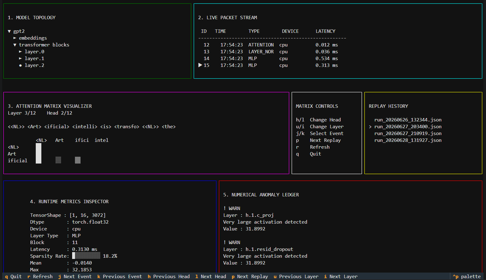

# DeepScope

**DeepScope** is a lightweight telemetry and diagnostics platform for transformer models. It non-invasively hooks into the model's forward pass, captures runtime execution statistics, and visualizes them through an interactive terminal dashboard.

<p align="center"> <b>Authors</b><br> Hemanga Sarma • Sheetal Shende </p>

## Tech Stack

- Python
- PyTorch
- Hugging Face Transformers
- Textual

## Features

- Non-invasive forward hook instrumentation
- Layer-wise execution latency profiling
- Multi-layer & multi-head attention visualization
- Runtime tensor statistics
  - Shape
  - Device
  - Dtype
  - Mean, Max, Std
  - Sparsity
- Numerical anomaly detection
- Replay support
- Fixed-size ring buffer
- Interactive keyboard-driven TUI

## Dashboard
<p align="center">
  
</p>
<!--  -->

Full demo: https://drive.google.com/file/d/1XVbwtzum3s6lqVFi0UYVZrq2TuP2gYP6/view?usp=drive_link

- Model Topology
- Live Packet Stream
- Attention Matrix Visualizer
- Runtime Metrics Inspector
- Replay History
- Numerical Anomaly Ledger


## Keyboard Shortcuts

| Key | Action |
|------|--------|
| `j / k` | Navigate events |
| `u / i` | Change transformer layer |
| `h / l` | Change attention head |
| `p` | Replay history |
| `r` | Refresh |
| `q` | Quit |


## Run

```bash
pip install -r requirements.txt

python main.py
python frontend/app.py
```

## Project Structure

```text
DeepScope/
│
├── frontend/
│   ├── app.py                 # Textual application
│   ├── dashboard.py           # Dashboard layout
│   └── __init__.py
│
├── hooks/
│   ├── hook_manager.py        # Forward hooks & telemetry collection
│   ├── attention_buffer.py    # Attention matrix storage
│   ├── replay_manager.py      # Replay management
│   ├── ring_buffer.py         # Fixed-size event buffer
│   ├── telemetry.py           # Runtime statistics
│   └── anomaly_detector.py    # Numerical anomaly detection
│
├── runs/                   # Saved inference traces
│
├── metrics.json               # Live telemetry shared with the UI
├── main.py                    # Starts instrumentation & inference
├── requirements.txt
├── README.md
└── LICENSE
```

---

## Assumptions

- The project is currently tested with GPT-2 from Hugging Face Transformers.
- The model runs on CPU by default; CUDA/GPU will be shown if the model is moved to a CUDA device.
- Telemetry is exported to `metrics.json`, which is read by the TUI frontend.
- Replay traces are saved locally in the `runs/` directory.
- The dashboard is designed as a local debugging and visualization tool.

## Additional Features

- Multi-layer attention navigation using `u / i`
- Multi-head attention navigation using `h / l`
- Replay history panel for saved inference traces
- Effective sparsity tracking using activation thresholding
- Numerical anomaly ledger for large activations and high variance
- Runtime packet stream with latency and device information
- Active transformer block highlighting in model topology
